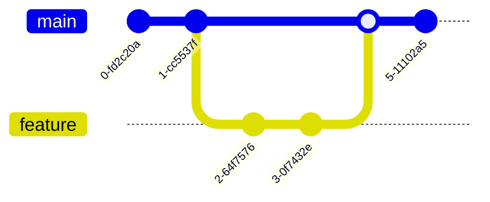

# Portfolio Personal Website

هذا المشروع هو موقع شخصي/بورتفوليو يضم معلومات عن صاحب المشروع، أعماله، المشاريع، وأدواته التقنية.

## الوصف

الموقع يعرض:
- نبذة عن صاحب المشروع
- المشاريع و الروابط
- أعمال GitHub
- أتمتة n8n
- خدمات تطوير الويب وإدارة السيرفرات
- صفحات رئيسية في الجذر

## هيكل المشروع

```text

## التشغيل

للمشاريع البسيطة مثل هذا الموقع، يمكنك فتح أي ملف HTML مباشرة في المتصفح، أو استخدام خادم محلي بسيط مثل:

```bash
python -m http.server 8000
```

ثم افتح:

```text
http://localhost:8000
```

## ملاحظات هامة

- تم تحديث الصفحات الأساسية في الجذر فقط.
- ملف `robots.txt` مخصص لعمليات فهرسة الموقع.
- تم إنشاء `sitemap.xml` لسهولة فهرسة الصفحات الأساسية.

## المراجع / الملفات المهمة

- [index.html](index.html)
- [projects.html](projects.html)
- [style.css](style.css)
- [robots.txt](robots.txt)
- [sitemap.xml](sitemap.xml)
- [SEO-AUDIT.md](SEO-AUDIT.md)

## الترخيص

هذا المشروع مخصص للاستخدام التعريفي/الportfolio للمؤلف. تم التعديل وفق احتياج المشروع المحلي.
